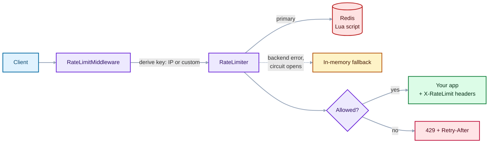

<div align="center">

# API Rate Limiter

**Async rate limiting for Python APIs: three algorithms, Redis or in-memory storage, automatic fallback, and drop-in ASGI middleware.**


Part of the [RedTeaming](https://github.com/20MH1A04H9/RedTeaming) collection by [@20MH1A04H9](https://github.com/20MH1A04H9).

</div>

---

## Why this exists

Rate limiting is one of the cheapest and most effective API defences. It blunts brute-force logins, credential stuffing, scraping, and abusive clients, and it keeps a single noisy caller from starving everyone else.

This project is a small, readable implementation that shows how the pieces fit together:

- how the common algorithms differ and when to use each
- how to share limits across multiple app servers with **atomic Redis Lua scripts**
- how to **degrade gracefully** when the backend goes down
- how to plug it into any ASGI app as middleware

## Features

| | |
|---|---|
| **Algorithms** | Token bucket, sliding window (exact log), fixed window |
| **Storage** | In-memory (single process) or Redis (shared across instances) |
| **Resilience** | Falls back to in-memory limits if Redis fails; circuit breaker skips the backend for a cooldown period; choose fail-open or fail-closed |
| **Middleware** | Pure ASGI, so it works with FastAPI, Starlette, or any ASGI framework |
| **Standard responses** | `429 Too Many Requests` with `Retry-After`, plus `X-RateLimit-Limit` and `X-RateLimit-Remaining` headers |
| **Per-request cost** | Charge more than one token for expensive endpoints |
| **Safe by default** | Proxy headers are ignored unless you opt in; health checks are exempt |
| **Memory hygiene** | Idle keys are swept periodically so the in-memory store doesn't grow without bound |

## How it works



1. The middleware derives a key for each request (client IP by default, or your own function).
2. `RateLimiter` asks the primary backend whether the request is allowed.
3. If the backend errors, the limiter switches to the fallback for a cooldown period instead of failing every request.
4. Allowed requests continue to your app with rate-limit headers added. Blocked requests get a `429`.

## Quick start

```bash
git clone https://github.com/20MH1A04H9/RedTeaming.git
cd "RedTeaming/API Rate Limiter"

python3 -m venv .venv && source .venv/bin/activate
pip install -e ".[demo]"

uvicorn examples.demo:app
```

Open `http://127.0.0.1:8000` and refresh. Watch `X-RateLimit-Remaining` count down in your browser's network tab, or use curl:

```bash
for i in $(seq 1 15); do curl -s -o /dev/null -w "%{http_code}\n" http://127.0.0.1:8000/; done
```

Expected: about ten `200` responses, then `429`. The demo bucket holds 10 tokens and refills 1 per second.

### With Redis

```bash
docker run -d -p 6379:6379 redis:7-alpine
REDIS_URL=redis://localhost:6379 uvicorn examples.demo:app --workers 2
```

With Redis, both workers share one limit. Without it, each process keeps its own, so two workers allow roughly twice the configured limit.

If port 8000 is busy, add `--port 8001` and use that port in the commands below.

## Usage

### FastAPI

```python
from fastapi import FastAPI
from viswa_ratelimiter import RateLimiter, RateLimitMiddleware, TokenBucket

app = FastAPI()

limiter = RateLimiter(TokenBucket(capacity=10, refill_per_sec=1))
app.add_middleware(RateLimitMiddleware, limiter=limiter)
```

### Redis with in-memory fallback

```python
import redis.asyncio as redis
from viswa_ratelimiter import RateLimiter, RateLimitMiddleware, TokenBucket
from viswa_ratelimiter.redis_store import RedisTokenBucket

client = redis.from_url("redis://localhost:6379")

limiter = RateLimiter(
    primary=RedisTokenBucket(client, capacity=10, refill_per_sec=1),
    fallback=TokenBucket(capacity=10, refill_per_sec=1),  # used if Redis is down
    cooldown=5.0,                                         # seconds to skip Redis after a failure
)
app.add_middleware(RateLimitMiddleware, limiter=limiter)
```

### Stricter limits for sensitive endpoints

Use the sliding window for logins and other abuse-prone routes, where the "burst at the window boundary" behaviour of a fixed window is unacceptable:

```python
from viswa_ratelimiter import SlidingWindow

login_limiter = SlidingWindow(limit=5, window=60)   # 5 attempts per rolling minute

result = await login_limiter.check(f"login:{client_ip}")
if not result.allowed:
    ...  # return 429 with result.retry_after
```

### Custom keys (per user or API key)

```python
def by_api_key(scope):
    for name, value in scope["headers"]:
        if name == b"x-api-key":
            return value.decode()
    return "anonymous"

app.add_middleware(RateLimitMiddleware, limiter=limiter, key_func=by_api_key)
```

### Response behaviour

Allowed request:

```
HTTP/1.1 200 OK
x-ratelimit-limit: 10
x-ratelimit-remaining: 7
```

Blocked request:

```
HTTP/1.1 429 Too Many Requests
retry-after: 2
x-ratelimit-limit: 10
x-ratelimit-remaining: 0
content-type: application/json

{"detail": "Too Many Requests", "retry_after": 2}
```

## Demo results

Tested on Kali Linux with the demo app (bucket of 10, refill 1 token/second):

| Test | Result |
|---|---|
| 25 rapid requests, in-memory, 1 worker | 10 × `200`, then `429` |
| Response headers | `x-ratelimit-limit: 10`, `x-ratelimit-remaining` counts down |
| 25 rapid requests, Redis, 2 workers | 10 × `200`, then `429`: both workers share one bucket |
| Redis key created | `viswa:tb:127.0.0.1` |
| 6 s after the limit was hit | Bucket refilled: 10 × `200`, then `429` again |

<!-- Add screenshots here, e.g.  -->

## Choosing an algorithm

| Algorithm | Allows bursts | Accuracy | Memory per key | Backends | Best for |
|---|---|---|---|---|---|
| **Token bucket** | Yes, up to capacity | Good | O(1) | Memory, Redis | General APIs; smooth average rate with tolerated bursts |
| **Sliding window** | No | Exact | O(requests in window) | Memory, Redis | Login, password reset, OTP endpoints |
| **Fixed window** | At window edges (up to 2x) | Approximate | O(1) | Memory | Cheap, coarse limits where precision doesn't matter |

## Configuration reference

| Option | Where | Default | Description |
|---|---|---|---|
| `capacity` / `refill_per_sec` | `TokenBucket`, `RedisTokenBucket` | required | Burst size and sustained rate |
| `limit` / `window` | `SlidingWindow`, `FixedWindow`, `RedisSlidingWindow` | required | Max requests per window (seconds) |
| `fallback` | `RateLimiter` | `None` | Backend used when the primary fails |
| `fail_open` | `RateLimiter` | `False` | With no fallback and a failed primary: `True` allows traffic, `False` blocks it |
| `cooldown` | `RateLimiter` | `5.0` | Seconds to skip the primary after a failure |
| `key_func` | `RateLimitMiddleware` | client IP | Function that returns the rate-limit key for a request |
| `trust_proxy` | `RateLimitMiddleware` | `False` | Read the client IP from `X-Forwarded-For` |
| `exempt_paths` | `RateLimitMiddleware` | `("/health",)` | Paths that skip limiting |

## Security notes

- **`trust_proxy` is off by default.** Enable it only when the app sits behind a proxy you control that overwrites `X-Forwarded-For`. Otherwise a client can send a forged header and get a fresh bucket on every request.
- **Pick fail-open or fail-closed deliberately.** Fail-open favours availability; fail-closed (the default) favours protection. A fallback limiter gives you a middle path.
- **Redis time is authoritative.** The Lua scripts read `TIME` from Redis, so clock skew between app servers cannot be used to bypass limits.
- **Limits are atomic.** Each check runs as a single Lua script, so concurrent requests can't race past the limit.
- **In-memory limits are per process.** With multiple workers and no Redis, each worker enforces its own limit, so the effective limit is higher than configured.
- **IP-based keys have limits.** Users behind a shared NAT share a bucket, and attackers with many IPs evade it. Combine with per-account or per-API-key limits for sensitive flows.

## Troubleshooting

| Symptom | Cause | Fix |
|---|---|---|
| `[Errno 98] Address already in use` | An earlier uvicorn is still bound to the port. Requests then hit the old server, which can hide the behaviour you meant to test | `sudo ss -ltnp \| grep 8000`, then stop that process (or use `--port 8001`) |
| `Could not connect to Redis ... Connection refused` | Redis isn't running | `sudo service redis-server start`, then `redis-cli ping` should print `PONG` |
| No `429` with `--workers 2` and no Redis | Each worker keeps its own in-memory bucket | Run with `REDIS_URL` set, or use a single worker |
| `redis-cli keys 'viswa:*'` is empty | The app is not using Redis (not started with `REDIS_URL`, or it fell back to memory) | Check the server log for `rate limit backend failed` |
| `rate limit backend failed ... using fallback` in the log | Redis is unreachable; the limiter switched to in-memory limits | Restore Redis; the limiter retries after the cooldown (5 s by default) |

## Project structure

```
RedTeaming/API Rate Limiter/
├── src/viswa_ratelimiter/
│   ├── algorithms.py     # TokenBucket, SlidingWindow, FixedWindow (in-memory)
│   ├── redis_store.py    # RedisTokenBucket, RedisSlidingWindow (Lua scripts)
│   ├── limiter.py        # RateLimiter: fallback + circuit breaker
│   └── middleware.py     # Pure-ASGI middleware, client IP helper
├── tests/
│   └── test_ratelimiter.py
├── examples/
│   └── demo.py           # FastAPI demo app
├── pyproject.toml
└── LICENSE
```

## Running the tests

```bash
PYTHONPATH=src python3 -m unittest discover -s tests -v
```

The suite covers burst and refill behaviour, the sliding-window retry calculation, fixed-window resets, per-request cost, fallback and fail-open/closed behaviour, and the middleware's `429` and exempt-path handling. Tests use an injected fake clock, so they are fast and deterministic. A few "redis down" log lines in the output are expected: those tests simulate a backend failure.

## What you'll learn from this project

- Token bucket maths and why it tolerates bursts
- Why a fixed window can allow double the limit at a boundary, and how a sliding window fixes it
- Writing atomic, distributed counters with Redis Lua scripts
- Graceful degradation and circuit breakers
- How ASGI middleware wraps requests and responses

## License

Released under the [MIT License](LICENSE).
